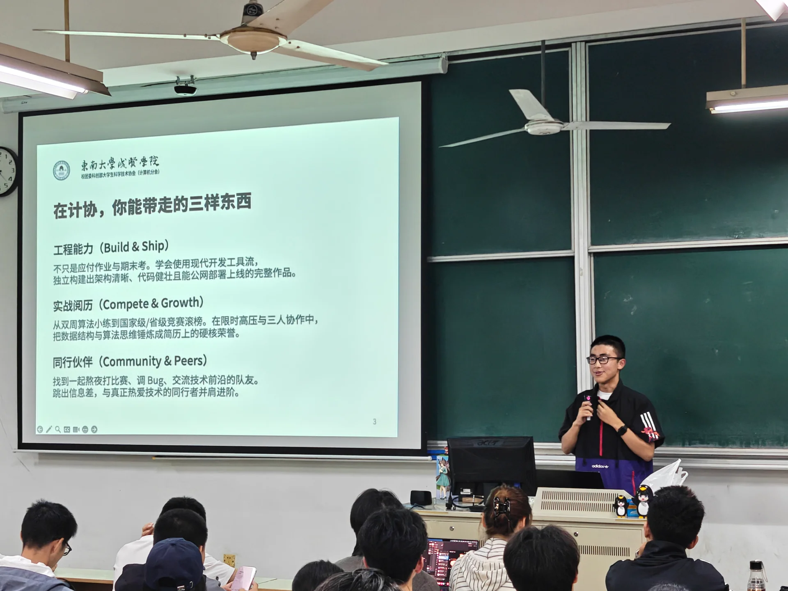
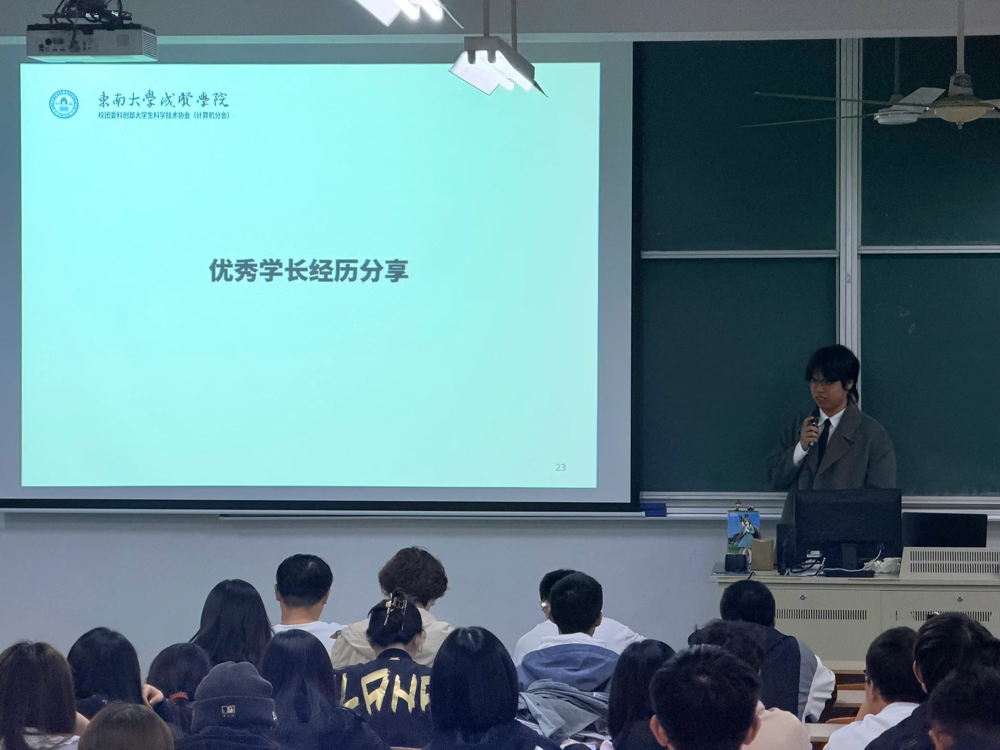
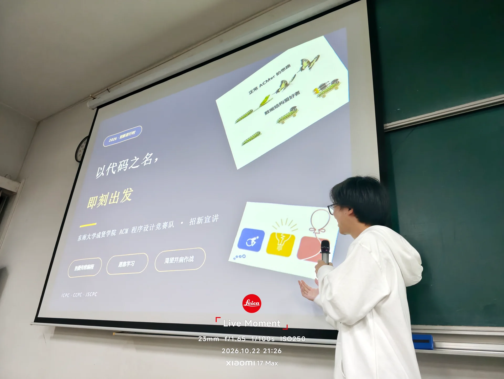
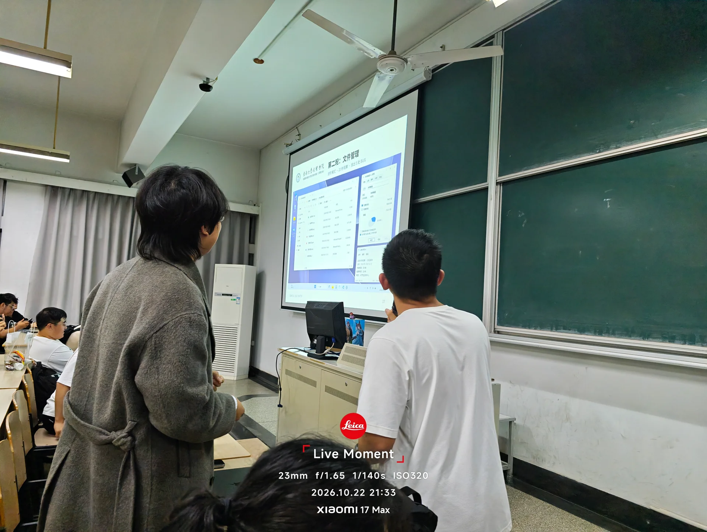
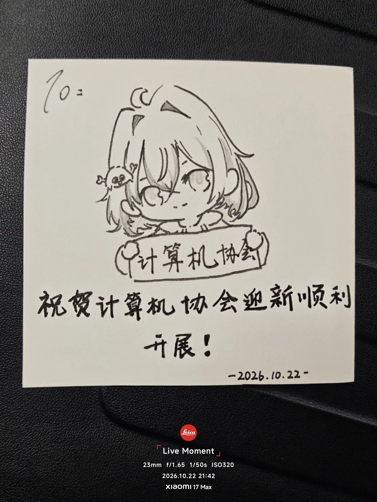
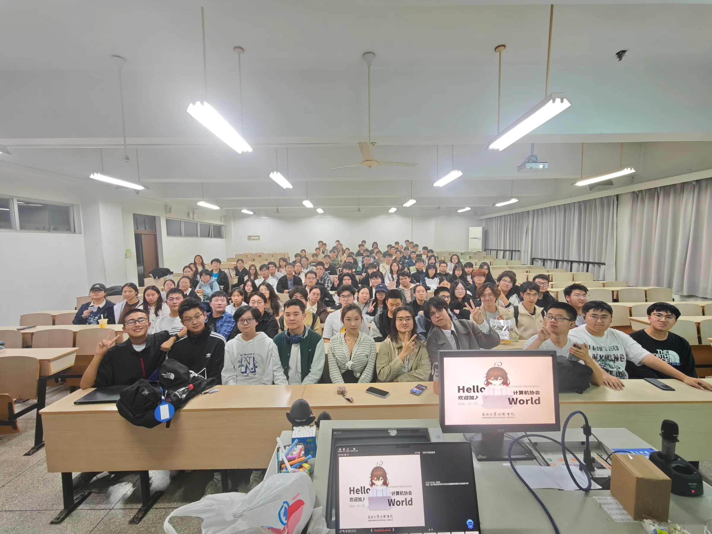
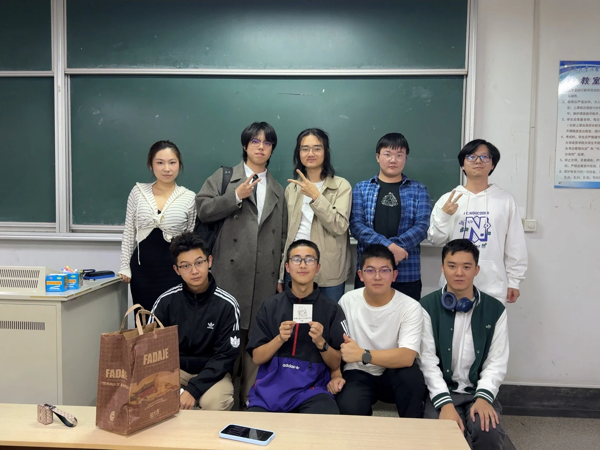

10月22日晚，东南大学成贤学院计算机协会于阶梯教室举办2026年新生欢迎会。协会指导骨干、历任核心团队与2026级新成员齐聚一堂，共话技术成长，开启新学年的科技实践篇章。

本次欢迎会在筹备阶段便展现了鲜明的工程与技术特色。为优化迎新流程与社团数字化建设，计协团队提前完成专属成员卡的制作与发放，并全面接入协会自研的 AMS（社团管理系统）。通过数字化工具的高效协同，活动实现了新成员身份的高效录入与管理，也让新生在入会之初便直观感受到了社团“学以致用、用以促学”的技术沉淀。

欢迎会由现任会长贾宇辰主持。随着投影亮起，贾宇辰围绕协会的历史定位、组织架构与本学期活动规划展开介绍。他系统阐述了协会涵盖算法训练、工具研讨、软硬件开发与校外研学在内的多维实践体系，并针对新生普遍关注的零基础入门、学习资源获取及技术路线选择等问题作了解答。贾宇辰表示，计协始终倡导“开放、平等、务实”的技术氛围，致力于为每位怀揣技术热情的同学搭建没有门槛的交流平台。

在骨干交流环节，现任与历任管理团队依次与新同学见面。现任会长贾宇辰、副会长王启轩、副会长刘佳昊、会长助理陈希禹，以及上届会长朱昕鋆、上届副会长孙博文、王文腾等先后分享了各自深耕的技术方向与实践历程；副会长王启轩精心准备的个人出场视频更是活跃了现场气氛。

随后，优秀学长卜乐宇结合自身的大学成长路径带来主题分享，围绕专业学习、技术自驱力养成及大学阶段的心态规划与新成员坦诚交流，提供了宝贵的经验借鉴。

在竞赛专题模块，负责学科竞赛的副会长刘佳昊与上届副会长王文腾结合自身备战经历，深入剖析了程序设计竞赛的备赛方法、训练节奏与团队配合逻辑。王文腾详细介绍了学校 ACM 程序设计竞赛队的梯队建设、三人单机赛制特点与往届赛场荣誉，并正式公布了面向2026级新生的集训招新计划与考核渠道，鼓励大家通过系统训练稳步迈入高水平算法竞技赛场。

为活跃现场气氛，活动设置了“找 BUG”与“内存溢出挑战”两项思维互动游戏，通过界面细节排查与短时记忆考验，拉近了新老成员之间的距离。穿插其间的三轮抽奖活动送出了定制礼品，进一步点燃了现场热情。

一位学妹还向协会赠送了迎新主题手绘，作品上题写“祝贺计算机协会迎新顺利开展！”，为活动送上祝福。

活动最后，参会同学在教室内合影留念，协会成员也在黑板前留下合照。本次欢迎会让新成员认识了协会，也为接下来一起学习、参加活动和动手做项目提供了交流的起点。

_迎新会全体合影。_

_计算机协会办公室成员合影。_
